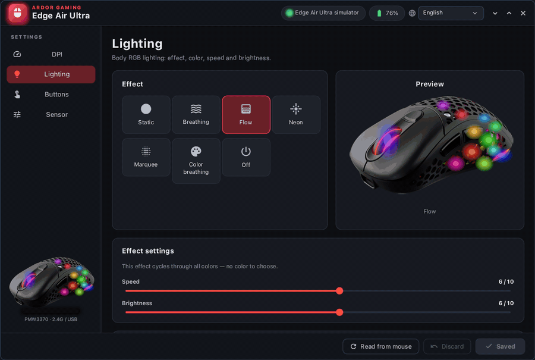
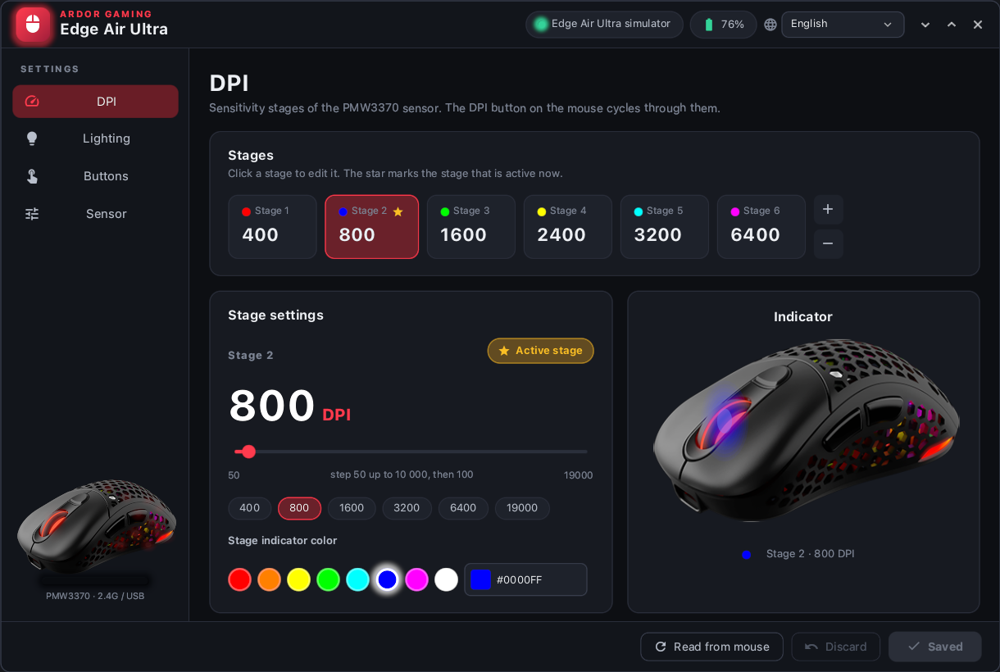
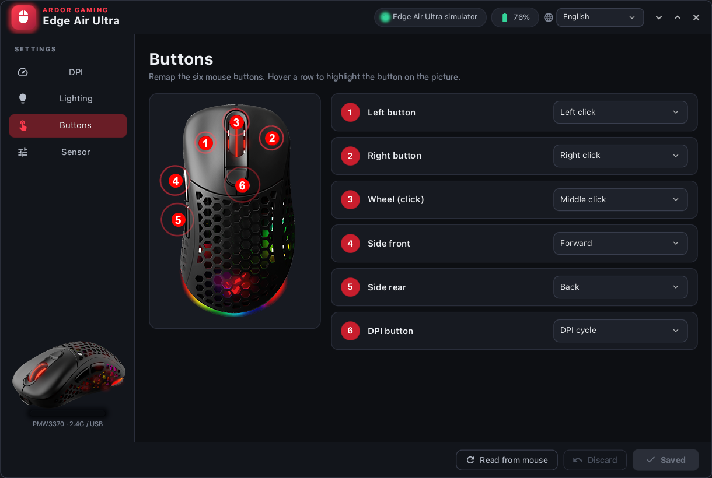
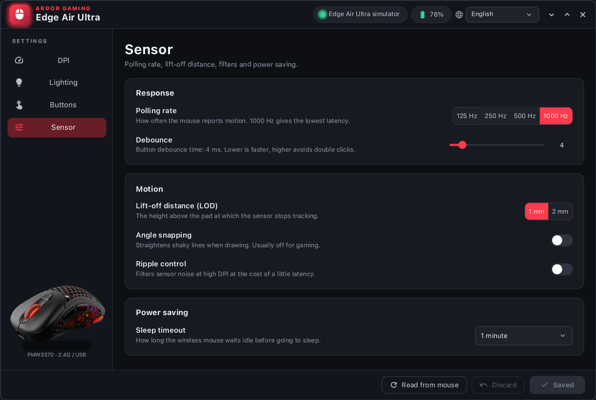
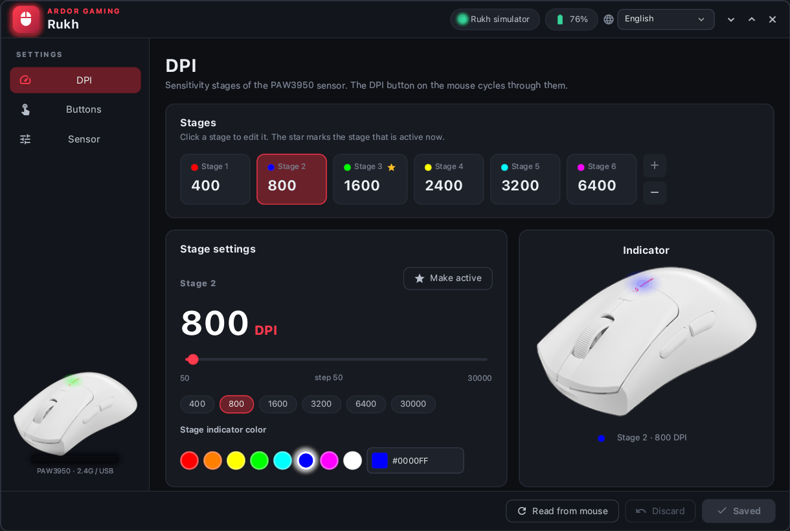

# ardor-mouse

[](#how-it-is-built)
[](https://aur.archlinux.org/packages/ardor-mouse)
[](https://github.com/VitaminDB/ardor-mouse/releases)

A native Linux configuration tool for **ARDOR GAMING** wireless mice — the **Edge Air Ultra**
and the **Rukh** — a replacement for the vendor's Windows-only utilities.

The vendor ships no Linux software and publishes no protocol. Everything here was
reverse-engineered: the Windows utilities were decompiled, their USB traffic compared against
live mice, and every EEPROM field verified on real dumps. Written in Rust on
[syngui](https://github.com/VitaminDB/syngui); talks to the mouse directly through `hidraw` —
no kernel module, no daemon, no root.



| DPI | Buttons | Sensor |
|---|---|---|
|  |  |  |

| Rukh | English interface |
|---|---|
|  |  |

## What it does

- **Live mouse** — the picture of your mouse in the app glows the way the real one will: the
  lighting effect plays at the chosen speed and brightness, the DPI indicator flashes in the
  stage color, and hovering a button in the list highlights it on the mouse.
- **DPI** — up to 8 stages (6 on the Rukh), 50–19 000 DPI on the Edge Air Ultra and
  50–30 000 on the Rukh, each with its own indicator color; choose the active stage.
- **RGB lighting** (Edge Air Ultra) — 7 effects: static, breathing, flow, neon, marquee, color
  breathing, off; color, speed, brightness, lights off while moving.
- **Buttons** — remap all 6 buttons: clicks, back/forward, DPI cycle / up / down, disable.
  Functions the app cannot edit (macros, fire button) are kept as they are.
- **Sensor** — polling rate 125–1000 Hz (2000 Hz on the Rukh), lift-off distance 1/2 mm
  (0.7 mm on the Rukh), debounce, angle snapping, ripple control, sleep timeout; Motion Sync
  and LP/HP sensor mode on the Rukh.
- **Battery** level and charging state.
- **Languages** — English, Русский, Українська, Қазақша, Deutsch; follows the system language,
  switchable from the title bar without a restart.

Settings are read from the mouse's own memory and only the changed regions are written back,
so the tool never overwrites what it does not understand.

## Supported hardware

| Mouse | Sensor | Connection | USB ID |
|---|---|---|---|
| Edge Air Ultra | PixArt PMW3370 | 2.4 GHz receiver | `25a7:fa7c` |
| Edge Air Ultra | | USB cable | `25a7:fa7b` |
| Rukh | PixArt PAW3950 | 2.4 GHz receiver | `3554:f53e` |
| Rukh | | USB cable ¹ | `3554:f53d` |

Both mice use a JM03 (Compx) controller with the same command set and EEPROM map; what
differs between them is listed in [`src/protocol/model.rs`](src/protocol/model.rs).

¹ Taken from the vendor's `Config.ini`; not tested — on the tested unit the cable only charges.

## Install

### Arch Linux (AUR)

```bash
yay -S ardor-mouse        # or paru -S ardor-mouse
```

The package installs `/usr/bin/ardor-mouse`, a menu entry, icons and a udev rule that gives
the logged-in user access to the mouse. If the receiver was already plugged in, replug it once.

### Prebuilt binary

Each [release](https://github.com/VitaminDB/ardor-mouse/releases) has a
`ardor-mouse-<version>-x86_64-linux.tar.gz` with the binary, the udev rule, the menu entry and
icons. Unpack it and run `sudo ./install.sh`.

### From source

Requires a recent stable Rust and the usual graphics stack (Vulkan or GL driver, Wayland or X11).

```bash
git clone https://github.com/VitaminDB/ardor-mouse
cd ardor-mouse
cargo build --release
sudo install -Dm644 packaging/70-ardor-mouse.rules /etc/udev/rules.d/70-ardor-mouse.rules
sudo udevadm control --reload-rules && sudo udevadm trigger
./target/release/ardor_mouse
```

The udev rule tags the mouse's `/dev/hidraw*` nodes with `uaccess`, so no `sudo` is needed to
run the app.

## Usage

```bash
ardor-mouse                       # configure the connected mouse
ardor-mouse --simulate [rukh]     # demo mode with a simulated mouse — no hardware needed
ardor-mouse --lang en             # interface language for this run
ardor-mouse --read-only           # never write to the mouse
ardor-mouse --probe               # check the mouse from the terminal: read and verify the profile
ardor-mouse --probe --write-test  # …and write a setting, read it back, revert it
ardor-mouse --dump FILE           # save the raw profile image that is read first
ARDOR_TRACE=1 ardor-mouse         # print every packet exchanged with the mouse to stderr
```

If the mouse is asleep, the receiver answers but the mouse memory is unreachable — move the
mouse and the settings load by themselves.

## Protocol

For anyone porting this to another tool or another mouse on the same controller.

- The receiver exposes several HID interfaces with the same VID/PID; the command interface is
  found by report `0x08` in its report descriptor.
- **Request** — report `0x08`, 17 bytes. The Edge Air Ultra takes it as a *feature* report
  (`ioctl(HIDIOCSFEATURE(17))`), the Rukh as an *output* report (`write()`):

  ```text
  [08] [cmd] [00] [addr_hi] [addr_lo] [len] [data × 10] [0x55 − Σ]
  ```

- **Response** — an input report in the same layout: ID `0x09` on the Edge Air Ultra, `0x08`
  on the Rukh; byte `[2]` is the status (`0` = OK).
- **Commands** — `03` link status, `04` battery, `07` write EEPROM, `08` read EEPROM;
  the Rukh also sends `0A` on its own when a setting changes on the mouse.
- **Profile EEPROM** (`0x00…0xBF`): polling rate, DPI count and active stage, lift-off
  distance, 8 DPI stages, 8 DPI colors, 16-entry button matrix, lighting block, debounce,
  motion sync, sleep timeout, angle snapping, ripple control, sensor mode. The full map with
  value encodings is in [`src/protocol/eeprom.rs`](src/protocol/eeprom.rs), the two DPI codecs
  (8-bit PMW3370, 10-bit PAW3950) in [`src/protocol/dpi.rs`](src/protocol/dpi.rs).

## Project layout

```text
src/protocol/   packets and checksums, models, DPI codecs, lighting, buttons, EEPROM map
src/transport/  hidraw (real device), sim (simulator), Device (commands)
src/worker.rs   background thread that talks to the mouse
src/probe.rs    --probe: terminal check of a real mouse
src/ui/         the window: title bar, live mouse view, DPI, lighting, buttons, sensor pages
i18n/           translations (source strings are Russian; en, uk, kk, de catalogs)
packaging/      udev rule, .desktop entry, PKGBUILDs
```

`cargo test` runs 60 tests, including decoding of packets and EEPROM dumps captured from both
mice.

## Contributors

- [@Metisav](https://github.com/Metisav) — Rukh support: protocol from the vendor's Rukh
  utility, PAW3950 codec, Motion Sync, LP/HP, 2000 Hz, tested on a real Rukh
  ([#1](https://github.com/VitaminDB/ardor-mouse/pull/1)).

## How it is built

This project is vibe-coded. Since spring 2026 I write all of my projects with [Claude
Code](https://claude.com/claude-code): I decide what to build and how it fits together,
describe each task, and review, run and measure the result on my own hardware — the model
writes the code, the tests and most of the documentation. The protocol was reverse-engineered
from and tested on real mice.

## Disclaimer

Unofficial project, not affiliated with or endorsed by ARDOR GAMING. "ARDOR GAMING",
"Edge Air Ultra" and "Rukh" are trademarks of their owners; the mouse images in
`assets/skins/` are the vendor's and are used only to label the buttons and show the lighting.
Writing to the mouse EEPROM is done the same way the vendor utilities do it, but you use this
tool at your own risk.

## License

[MIT](LICENSE)
